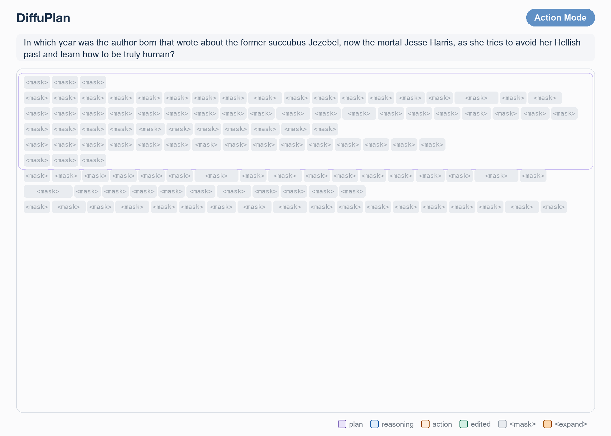

# DiffuPlan

Editable Planning State for Diffusion Language Model Agents

A real trajectory of the RL policy. Tokens are committed in denoising order, and Edit Mode updates `#A_1` and replans `#Q_2` where they are written in the plan.

Agents built on diffusion language models (dLLMs) usually keep the append-only state of autoregressive agents: once intermediate state is written, later evidence can only be added as more text. DiffuPlan instead maintains a single editable planning state. When later evidence resolves an intermediate answer or changes the search route, it reconstructs only the affected plan steps at their original position, conditioned on the preserved plan and the evidence retrieved after it. A shared block-diffusion model generates search actions in a block-causal Action Mode and edits the plan in a full-canvas Edit Mode. Expansion-Partition Marginalization (EPM) trains variable-length edits, and Agentic TraceRL improves multi-turn search decisions with a frozen SFT anchor.

## Contents

| Directory | Contents |
| --- | --- |
| Diffuplan/diffuplan_core | Action parsing, plan localization, edit denoising, commit, and search loop |
| Diffuplan/inference | Evaluation and interactive-question CLI |
| SFT/dFactory/tasks | Joint action/edit SFT and EPM |
| SFT/dFactory/VeOmni | Vendored training-runtime dependency |
| RL | Agentic TraceRL, rollout reconstruction, and fixed SFT anchor |
| configs | SFT, RL, and distributed-training configurations |
| benchmarks | Evaluation questions for the four multi-hop QA benchmarks |
| scripts | Training and inference entry points |

See [the implementation map](docs/implementation.md), [agent protocol](docs/protocol.md), and [data formats](docs/data.md) for details.

See [illustrative action sequences](examples/paper_traces.json) with abridged retrieved passages.

## Environment

Inference and RL use Linux with NVIDIA GPUs. The source runtime used Python 3.10, CUDA-enabled PyTorch 2.8.0, Transformers 4.57.0, SGLang 0.5.3.post1, and dInfer at the revision pinned in requirements/inference.txt.

In a dedicated environment with a CUDA-enabled PyTorch 2.8.0 installation:

    python -m pip install -r requirements/inference.txt

The retriever additionally requires a FAISS build matching its CPU or GPU execution mode. Set RETRIEVER_PYTHON_EXEC when it runs in a separate environment. The model checkpoint, passage corpus, and FAISS index are external inputs.

SFT uses the included VeOmni runtime. Create a separate Python 3.11 environment, install a CUDA-enabled PyTorch build, then install its dependencies:

    python -m pip install -e SFT/dFactory/VeOmni

## Retrieval and inference

Start the E5/Wiki18 retriever in one terminal:

    export RETRIEVER_ASSET_DIR=/path/to/wiki18_assets
    export RETRIEVER_PATH=/path/to/e5-base-v2
    export RETRIEVER_GPU_IDS=0,1,2,3
    bash Diffuplan/launch_retriever.sh

The asset directory contains e5_Flat.index and wiki-18.jsonl. GPU index sharding is enabled by default. For CPU retrieval, use a CPU FAISS installation and set RETRIEVER_USE_GPU=0.

Run the agent using a fine-tuned DiffuPlan checkpoint:

    bash scripts/infer.sh \
      --model-path /path/to/diffuplan_checkpoint \
      --input-file examples/questions.jsonl \
      --output outputs/predictions.json \
      --write-jsonl outputs/predictions.jsonl

The default search limit is five; inference settings are in configs/inference.json. For a single question, replace --input-file with --question. Use --retriever-url and --retriever-health-url for an existing retrieval endpoint. The CLI supports --help. It uses one complete rollout model per GPU in its default data-parallel mode.

## Evaluation

benchmarks/ contains the evaluation questions: 500 questions each from HotpotQA, 2WikiMultiHopQA, and MuSiQue, and all 125 Bamboogle questions. To evaluate a checkpoint on all four:

    bash scripts/infer.sh \
      --model-path /path/to/diffuplan_checkpoint \
      --dataset hotpotqa --dataset 2wiki --dataset musique --dataset bamboogle \
      --output outputs/benchmarks.json

The output summary reports EM, token F1, and SubEM for each dataset.

## Supervised fine-tuning

Collect teacher trajectories and convert them into action/edit records as described in [data preparation](docs/data.md). Point SFT_DATA at the prepared, optionally preweighted mixed JSONL file:

    MODEL_PATH=/path/to/base_model \
    SFT_DATA=/path/to/mixed_sft.jsonl \
    NPROC_PER_NODE=8 \
    bash scripts/train_sft.sh

The configuration is configs/sft.yaml. Training writes checkpoints under outputs/sft by default; OUT_DIR chooses another directory. The trainer supports unfused HF checkpoint export. Use the epoch-one SFT policy as the RL initialization and frozen reference for the released recipe.

## Agentic TraceRL

The RL training questions and checkpoint-selection sets are in RL/data (see [RL inputs](RL/data/README.md)). Start the retriever, then launch:

    MODEL_PATH=/path/to/sft_checkpoint \
    NPROC_PER_NODE=4 \
    bash scripts/train_rl.sh

The checkpoint-selection score is computed on the configured validation datasets. The fixed SFT reference is loaded separately, excluded from the optimizer, and evaluated on rollout slices, including zero-advantage groups.

configs/rl.yaml uses four B200 GPUs. Its SM100 expert kernels can be installed on a B200 machine with CUDA build tools and Conda available:

    bash RL/kernels/install_sm100.sh

The installer uses the local .kernel_runtime directory. Other CUDA GPU configurations can disable these hardware-specific paths through the existing overrides:

    MODEL_PATH=/path/to/sft_checkpoint bash scripts/train_rl.sh \
      training.sm100_expert_gemm=false dinfer.b200_moe_tiles=false

Set OUT_DIR to a fresh directory for each training run.

## License and attribution

Project code is released under Apache-2.0. Third-party headers and licenses are retained; see [third-party notices](THIRD_PARTY_NOTICES.md). Model weights and retrieval assets are supplied separately.
